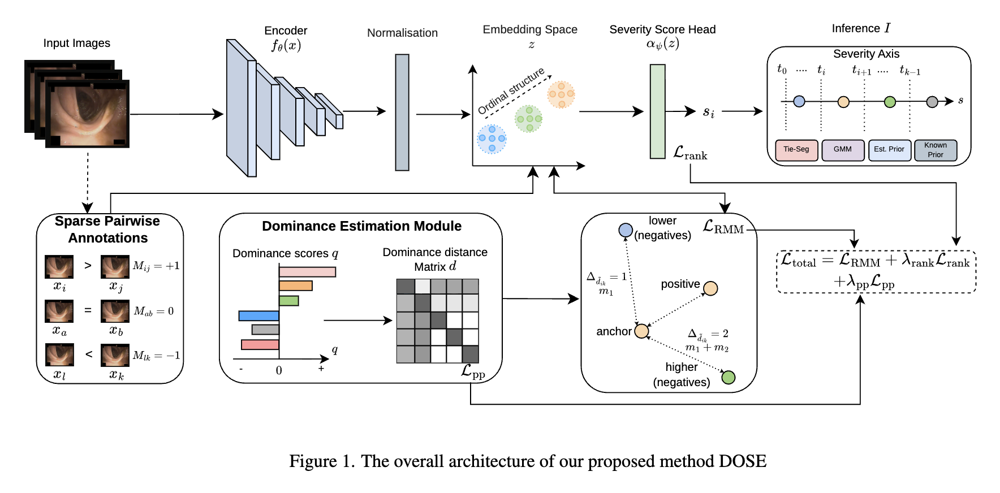

<div align="center">

# DOSE: Dominance-Guided Ordinal Severity Estimation from Sparse Relative Annotations

**Tushir Sahu**, *[co-authors]*

**WACV 2027**

[](#citation)
[](https://pytorch.org/)
[](LICENSE)

</div>

<p align="center">
  
</p>

## Overview

Clinical severity scales are ordinal, yet assigning an exact grade to an ambiguous image is hard
and inconsistent across experts, while judging *which of two images is more severe* is far more
reliable. **DOSE** learns ordinal severity estimation from **sparse pairwise comparisons alone**
(more severe / less severe / comparable) and still predicts **discrete grades**, without ever using
an absolute grade as a training target.

- **Global dominance.** Sparse comparisons are aggregated into one comparison graph, and Rank
  Centrality assigns every image a dominance score that carries transitive evidence across pairs
  that were never annotated.
- **Dominance-aware multi-margin loss.** Dominance gaps become label-free ordinal distances that set
  cumulative margins in the embedding space, so images that differ more in severity are separated
  more strongly.
- **Dominance pseudo-pairs.** A scalar severity head is trained on the annotated pairs together with
  confident pseudo-pairs derived from the dominance scores.
- **Label-free calibration.** Tie-anchored segmentation (Tie-seg) turns the continuous severity axis
  into K grades, using the "comparable" annotations as anchors and no class prior.

## Results

ConvNeXt-Tiny, 30% pair budget, Tie-seg calibration (mean over seeds; full tables in the paper).

| Method | Supervision | ACNE04 Acc / QWK | IDRiD Acc / QWK | LIMUC Acc / QWK |
|---|---|:---:|:---:|:---:|
| Cross-entropy | absolute grades (100%) | 78.6 / 0.822 | 86.6 / 0.914 | 78.0 / 0.848 |
| MarginRank | relative pairs | 71.2 / 0.788 | 81.2 / 0.878 | 73.9 / 0.844 |
| RankNet | relative pairs | 65.5 / 0.472 | 60.4 / 0.861 | 74.4 / 0.819 |
| **DOSE (ours)** | relative pairs | **72.6 / 0.807** | **84.5 / 0.909** | **77.5 / 0.857** |

DOSE outperforms both pairwise-ranking baselines on every dataset, and on LIMUC it exceeds the
fully supervised model in QWK despite never seeing an absolute grade.

## Installation

```bash
git clone https://github.com/TushirSahu/DOSE-Dominance-Guided-Ordinal-Severity-Estimation-from-Sparse-Relative-Annotations.git DOSE
cd DOSE
pip install torch torchvision numpy scikit-learn pillow tqdm
```

## Data preparation

We use [ACNE04](https://github.com/xpwu95/ldl), IDRiD (disease grading) and LIMUC. Download them
from their original sources and arrange each split with one folder per grade:

```
Acne_Split/
├── train/
│   ├── 0/  ├── 1/  ├── 2/  └── 3/
└── test/
    ├── 0/  ├── 1/  ├── 2/  └── 3/
```

Folders should be named by grade (`0`, `1`, ...); `grade_2` or `Mayo 3` style names also work.

**Relative annotations.** The benchmarks provide absolute grades, so comparisons are simulated from
them: every training image is compared with on average `--pairs_per_image` random partners, and each
compared pair receives `+1 / −1 / 0` (more / less / equally severe). The model only sees these signs;
absolute grades are used solely for test metrics and for the Known-prior oracle.

| Pair budget | ACNE04 (K=4) | IDRiD (K=5) | LIMUC (K=4) |
|---|:---:|:---:|:---:|
| 30% | 160 | 490 | 1600 |
| 50% | 290 | 790 | 2400 |
| 70% | 440 | 1090 | 3300 |

<sub>Values of `--pairs_per_image`. The training log reports the resulting pair coverage.</sub>

## Training

Defaults follow the paper: ConvNeXt-Tiny, 150 epochs, batch size 32 per GPU on 4 GPUs, light
augmentation, and `L = L_RMM + 0.5·L_rank + 0.5·L_pp`.

```bash
# 4-GPU DistributedDataParallel (default)
python train.py --data_dir ./Acne_Split/train --n_classes 4 --pairs_per_image 160 \
    --num_gpus 4 --seed 1234 --output_dir ./checkpoints/ACNE30_dose_s1234

# single GPU / CPU
python train.py --data_dir ./Acne_Split/train --n_classes 4 --pairs_per_image 160 \
    --no-distributed --output_dir ./checkpoints/ACNE30_dose_s1234
```

## Evaluation

```bash
python evaluate.py --checkpoint ./checkpoints/ACNE30_dose_s1234/dose_final.pth \
    --train-root ./Acne_Split/train --test-root ./Acne_Split/test \
    --n-classes 4 --pairs-per-image 160 --output-dir ./eval/ACNE30_dose_s1234
```

Reports accuracy, QWK, MAE and macro-F1 for the four score-to-grade routes and writes `summary.json`.

| Route | Uses | Type |
|---|---|---|
| **Tie-seg** | tie ("comparable") annotations only | label-free (main) |
| GMM | score distribution | label-free |
| Est-prior | GMM mixture weights | label-free |
| Known-prior | true training class proportions | oracle (reference only) |

## Reproducing the paper

Set the dataset paths at the top of each script and run from the repository root.

```bash
bash run.sh                          # DOSE over datasets × budgets × seeds (Tables 1, 2)
bash baselines/run_baselines.sh      # MarginRank and RankNet (Table 1)
bash baselines/run_supervised.sh     # cross-entropy upper bound (Table 1)
```

- **Margin ablation (Table 3):** uncomment `run single --single_margin` in `run.sh`.
- **Aggregate runs:** `python aggregate_results.py --eval_dir ./eval --latex`.
- The reported baseline runs use strong augmentation (`--aug strong`, set in
  `baselines/run_baselines.sh`); DOSE uses the default light augmentation.

<details>
<summary><b>Main training arguments</b></summary>

| Argument | Default | Description |
|---|---|---|
| `--pairs_per_image` | 170 | average annotated partners per image (pair budget) |
| `--backbone` | `convnext_tiny` | torchvision `resnet*`, `densenet*` or `convnext*` |
| `--lambda_clip` / `--lambda_rank` / `--lambda_pp` | 1.0 / 0.5 / 0.5 | loss weights |
| `--rank_loss` | `hinge` | severity-head ranking loss (`hinge` or `logistic`) |
| `--pp_tau` | 0.1 | minimum dominance gap for a pseudo-pair |
| `--no_dom_pairs` | off | disable dominance pseudo-pairs |
| `--single_margin` | off | one shared margin instead of cumulative margins |
| `--dominance` | `transitive` | `transitive` (Rank Centrality) or `copeland` |
| `--aug` | `light` | `light` (paper) or `strong` |

</details>

<details>
<summary><b>Repository structure</b></summary>

```
DOSE/
├── train.py              # training (DDP or single device)
├── evaluate.py           # score-to-grade calibration routes + metrics
├── model.py              # encoder, projection head, scalar severity head
├── dataset.py            # grade-folder dataset and sparse comparison graph
├── losses.py             # multi-/single-margin loss, ranking losses, dominance scores
├── calibration.py        # tie-anchored segmentation (Tie-seg)
├── eval_utils.py         # test loader, GMM / prior cut-offs, metrics
├── aggregate_results.py  # mean ± std over seeds
├── run.sh                # full DOSE experiment
├── baselines/            # MarginRank, RankNet, supervised cross-entropy
└── img/                  # figures
```

</details>

## Citation

If you find this work useful, please cite:

```bibtex
@inproceedings{sahu2027dose,
  title     = {{DOSE}: Dominance-Guided Ordinal Severity Estimation from Sparse Relative Annotations},
  author    = {Sahu, Tushir and others},
  booktitle = {Proceedings of the IEEE/CVF Winter Conference on Applications of Computer Vision (WACV)},
  year      = {2027}
}
```

## License

This project is released under the [MIT License](LICENSE).
